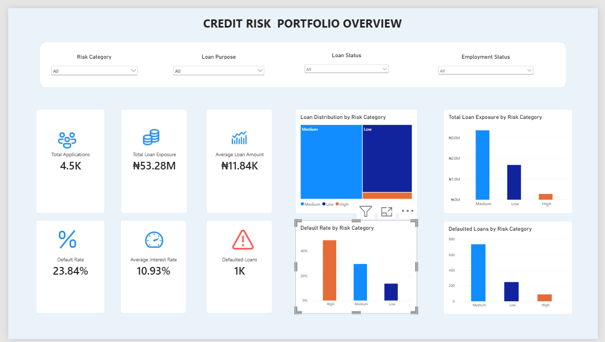
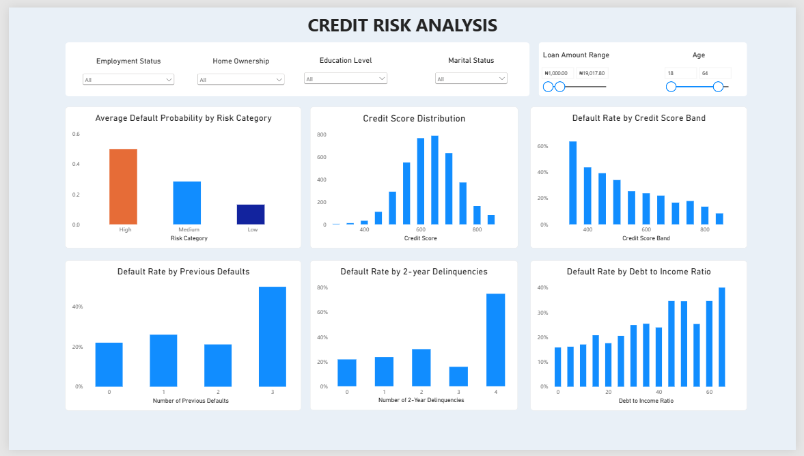
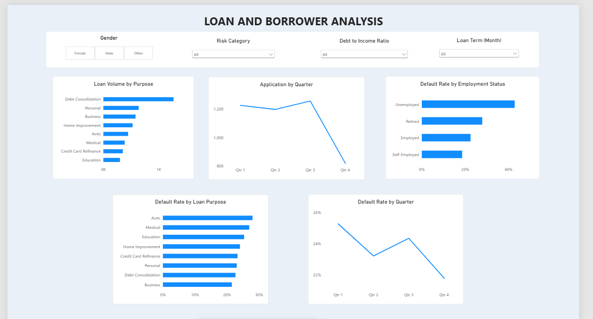

# SQL-Based Credit Risk Analysis

## Project Overview

This project demonstrates how SQL Server and Power BI can be used to analyse a lending portfolio, evaluate credit risk, and communicate financial insights through interactive dashboards.

The project combines SQL-based data preparation and analysis with Power BI visualisation to explore loan exposure, borrower characteristics, and default patterns.

## Objectives

- Assess overall loan portfolio performance and exposure.
- Examine default rates across credit risk categories.
- Investigate borrower characteristics associated with credit risk.
- Analyse lending patterns by loan purpose and employment status.
- Visualise loan application trends and default-rate performance over time.

## Tools and Technologies

- **Microsoft SQL Server** — data storage and SQL analysis.
- **SQL** — data preparation, quality checks, aggregations, and analytical views.
- **Microsoft Power BI** — interactive dashboards and visualisations.
- **DAX** — calculated measures and portfolio KPIs.
- **Git and GitHub** — version control and project documentation.

## Dataset

The project uses a synthetic loan dataset containing borrower demographics, financial characteristics, loan attributes, application dates, and loan outcomes.

The data was loaded into SQL Server, checked for data quality, and prepared for analysis.

## SQL Analysis

SQL analytical views support the following areas:

- Portfolio overview.
- Risk category performance.
- Loan characteristics.
- Borrower risk profiles.
- Risk exposure.
- Detailed credit risk analysis.

## Power BI Dashboards

### 1. Portfolio Overview

Summarises the lending portfolio through key metrics and charts covering:

- Total loan applications.
- Total loan exposure.
- Defaulted loans and default rate.
- Average loan amount and interest rate.
- Loan distribution and exposure by risk category.

### 2. Credit Risk Analysis

Investigates credit risk patterns through:

- Average default probability by risk category.
- Credit score distribution.
- Default rate by credit score band.
- Default rate by debt-to-income ratio.
- Default rate by previous defaults.
- Default rate by two-year delinquencies.

Filters support analysis across employment status, home ownership, education level, marital status, loan amount, and age.

### 3. Loan and Borrower Analysis

Examines lending behaviour and portfolio performance through:

- Loan volume by purpose.
- Loan exposure by purpose.
- Default rate by loan purpose.
- Default rate by employment status.
- Loan applications over time.
- Default rate over time.

## Key Metrics

The report includes total loan exposure, average loan amount, average interest rate, defaulted loans, and default rate.

Default rate is calculated as the number of defaulted loan records divided by the total number of loan records in the selected reporting context.

## Project Structure

- `sql/` — SQL scripts and analytical views.
- `data/` — project datasets.
- `dashboard/` — dashboard-related files.
- `screenshots/` — dashboard screenshots.
- `Credit-Risk-SQL-Analysis.pbix` — Power BI report.
- `README.md` — project documentation.

## Limitations

The dataset is synthetic and intended for demonstration. The findings should not be interpreted as evidence about a real lending institution. Observed associations between borrower characteristics and defaults do not establish causation.

## Future Improvements

- Add further credit risk indicators.
- Strengthen data validation and testing.
- Document analytical findings and business implications.
- Explore predictive modelling for credit risk assessment.

## Author

A portfolio project focused on SQL analytics, credit risk, financial data, and business intelligence.
